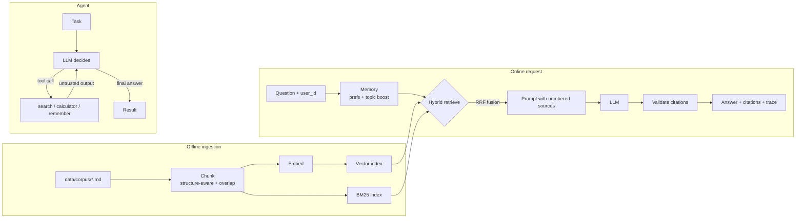

# grounded

**A small, readable answer engine — hybrid RAG with citations, a tool-using agent, personalization memory, tracing, and an evaluation harness.**

~1,400 lines of Python you can read in an afternoon. Runs fully offline out of the box (no API key), and switches to Claude, OpenAI, or a local Ollama model with one environment variable.

```
$ grounded ask "When is BM25 better than dense embeddings?"
BM25 is strong for names, codes, error messages and other exact strings that embeddings can blur. [1]
  [1] Embeddings and Vector Search (embeddings#2)

$ grounded agent "What is reciprocal rank fusion, and what is 1/(60+1) + 1/(60+3)?"
step 1: calculator({"expression": "1/(60+1) + 1/(60+3)"}) -> 0.032266
step 2: search_knowledge_base({"query": "What is reciprocal rank fusion..."}) -> <source id="1" ...
The result is 0.032266. Reciprocal rank fusion is a simple merge method ... [1]
```

## Why this exists

Modern AI product roles ask for experience with **LLMs, agents, retrieval systems, personalization and evaluation frameworks**, plus production habits: tests, observability, CI. This project covers each of those in the smallest honest form, with no framework hiding the mechanics.

| What teams ask for | Where it lives here |
|---|---|
| Retrieval systems | `retrieval.py` — BM25 from scratch, dense vector search, hybrid via Reciprocal Rank Fusion, MMR diversity |
| RAG with grounding | `rag.py` — numbered sources, citation-required prompt, hallucinated-citation stripping |
| Ingestion / chunking | `ingest.py` — structure-aware chunking with overlap and contextual chunk headers |
| Agents & tool use | `agent.py` — native tool calling, bounded loop, error recovery, sandboxed calculator, prompt-injection hygiene |
| Multiple LLM providers | `llm.py` — Claude (Messages API), any OpenAI-compatible server, deterministic mock |
| Personalization | `memory.py` — long-term user preferences + capped topic boosting, inspect/forget endpoints |
| Evaluation frameworks | `evals.py` — golden set, recall@k / MRR, correctness, citation precision, LLM-as-judge faithfulness, latency |
| Hill-climbing | `grounded eval` compares retrievers side by side; CI fails if recall regresses |
| Production systems | FastAPI service, request tracing with token usage, Docker, GitHub Actions, 31 tests |

## Architecture



## Quickstart

```bash
git clone https://github.com/<you>/grounded && cd grounded
python -m venv .venv && source .venv/bin/activate
pip install -e ".[dev]"

grounded ingest                       # chunk + embed data/corpus
grounded ask "What is nucleus sampling?" --trace
grounded agent "What is HNSW, and what is 2**10?"
grounded eval                         # writes reports/eval.md
pytest -q
```

Run the API and open the interactive docs at http://localhost:8000/docs:

```bash
uvicorn grounded.api:app --reload
curl -s localhost:8000/ask -H 'content-type: application/json' \
  -d '{"question": "Why does attention get expensive?", "user_id": "me"}'
```

### Use a real model

```bash
cp .env.example .env    # then edit, or export directly:
export GROUNDED_LLM=anthropic ANTHROPIC_API_KEY=sk-ant-...      # Claude
export GROUNDED_LLM=openai OPENAI_API_KEY=sk-...                # OpenAI
export GROUNDED_LLM=openai OPENAI_BASE_URL=http://localhost:11434/v1 GROUNDED_MODEL=llama3.1  # free, local
```

The default `mock` model is deliberately dumb (it extracts sentences by word overlap). It exists so tests and CI are deterministic and free. Compare its eval numbers with a real model's — that gap is the point.

## Evaluation

`grounded eval` runs 20 golden questions through every retriever:

| retriever | hit@k | recall@k | MRR | correct | cite prec | faithful |
|---|---|---|---|---|---|---|
| bm25 | 1.00 | 0.97 | 1.00 | 0.60 | 0.82 | 1.00 |
| vector | 0.95 | 0.93 | 0.95 | 0.60 | 0.72 | 0.95 |
| hybrid | 1.00 | 0.97 | 1.00 | 0.65 | 0.80 | 1.00 |

*(mock LLM, hashing embeddings, k=4.)* Retrieval and answer quality are measured separately on purpose: most RAG failures are retrieval failures, and you can't fix what you can't see.

## Design decisions

- **Hybrid retrieval with RRF.** Dense search handles paraphrase; BM25 handles exact strings (error codes, names). RRF merges by rank, so there's no score calibration between two incompatible scales.
- **Citations are validated, not trusted.** Citation numbers that don't map to a retrieved source are stripped before the answer is returned.
- **Agent safety.** Step limit stops runaway loops. Tool errors go back to the model as text so it can recover. Tool output is wrapped and labelled untrusted. The calculator parses an AST instead of calling `eval`.
- **Personalization changes style, not facts.** Preferences go into the system prompt; topic boosting is capped at 15% to avoid filter bubbles; users can view and delete their memory.
- **No framework.** LangChain/LlamaIndex are fine in production, but writing BM25, RRF and the agent loop by hand is how you learn what they do.

## Project layout

```
src/grounded/
  config.py      settings from env vars
  llm.py         Anthropic / OpenAI-compatible / mock clients, native tool calling
  text.py        tokenizer, light stemmer, sentence splitter
  ingest.py      loading + chunking
  embeddings.py  hashing embedder (offline) and API embedder
  retrieval.py   BM25, vector index, RRF, MMR, persistence
  rag.py         AnswerEngine: retrieve -> prompt -> generate -> validate
  agent.py       tool-using agent loop
  memory.py      per-user preferences and topic interest
  tracing.py     spans, latency, token usage -> .traces/traces.jsonl
  evals.py       golden-set metrics and reports
  api.py         FastAPI service
  cli.py         `grounded` command
data/corpus/     8 short docs on LLM topics (the knowledge base)
data/eval/       golden.jsonl — questions, relevant docs, answer keywords
tests/           31 offline tests, incl. provider wire-format tests via httpx.MockTransport
docs/            LEARNING_PATH.md — concepts, exercises, interview prep
```

## Roadmap

See [docs/LEARNING_PATH.md](docs/LEARNING_PATH.md) for a staged list: streaming responses, LLM reranker, query rewriting for follow-ups, pgvector backend, web-search tool, harder eval set, and online feedback.

## License

MIT
